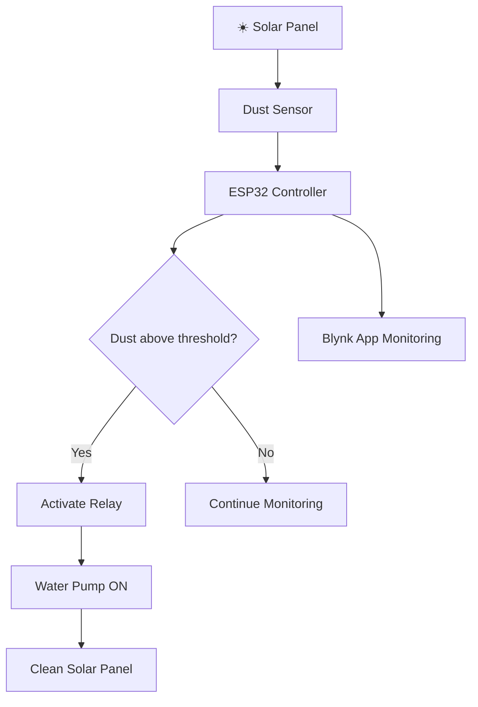

 

# 👋 Hi, I'm Sakshi!

**Information Science Student | Software Development | AI/ML Enthusiast**

---

## 👩‍💻 About Me

I'm a third-year Information Science Engineering student at **RV College of Engineering, Bengaluru**, passionate about building technology-driven solutions and continuously expanding my technical skills.

I enjoy exploring how software, intelligent systems, and emerging technologies can solve real-world problems. Through academic projects and hands-on experimentation, I'm developing my problem-solving and software development abilities.

- 🎓 Pursuing B.Tech in Information Science Engineering.
- 💻 Building projects using programming, web development, and IoT technologies.
- 🧠 Strengthening my Data Structures and Algorithms skills using C++.
- 🤖 Exploring Artificial Intelligence and Machine Learning.
- 🔐 Interested in Cybersecurity and Software Engineering.
- 🚀 Always eager to learn, collaborate, and turn ideas into practical solutions.

---

## 🛠️ Tech Stack

### Programming Languages

### Web Development

### AI / ML & Databases

### Tools & Platforms

---

## 🚀 Featured Projects

<table>
<tr>
<td width="50%" valign="top">

### 📊 IO Insight Quest

**I/O Bottleneck Analyzer**

An interactive dashboard that visualizes simulated disk I/O performance metrics, helping demonstrate throughput, latency, utilization, and potential bottlenecks.

**Tech Stack**

`React` `TypeScript` `Vite` `Recharts`

</td>
<td width="50%" valign="top">

### ☀️ Automatic Solar Panel Cleaning System

**IoT-Based Smart Cleaning**

An IoT-based system that monitors dust accumulation on solar panels and automatically activates a water pump when dust crosses a predefined threshold. Blynk provides remote monitoring.

**Tech Stack**

`ESP32` `IoT` `Dust Sensor` `Blynk`

</td>
</tr>
</table>

### ☀️ How the Solar Cleaning System Works

---

## 📈 GitHub Analytics

---

## 🎯 Currently Learning

- Data Structures and Algorithms with C++
- Software Development and Problem Solving
- Artificial Intelligence and Machine Learning
- Cybersecurity Fundamentals

---

## 🤝 Let's Connect

  

⭐ *Learning continuously. Building meaningfully. Growing every day.*

